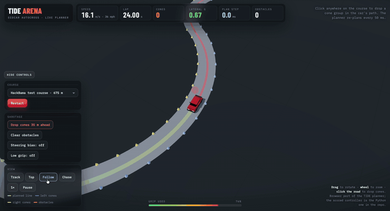
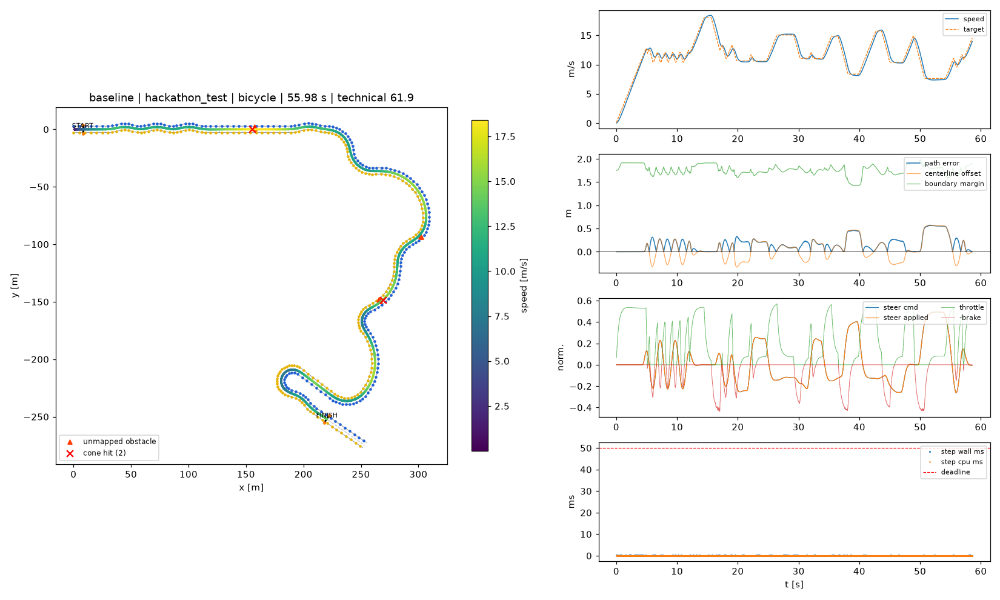
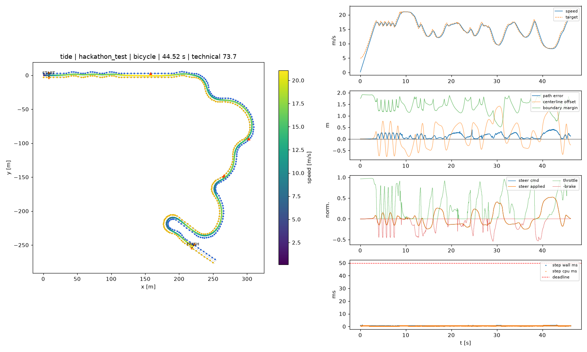
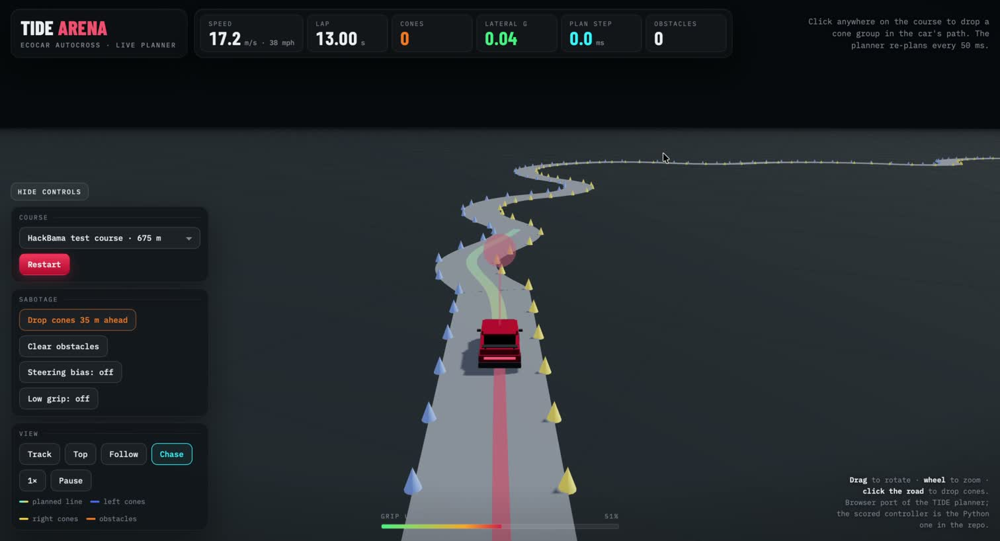
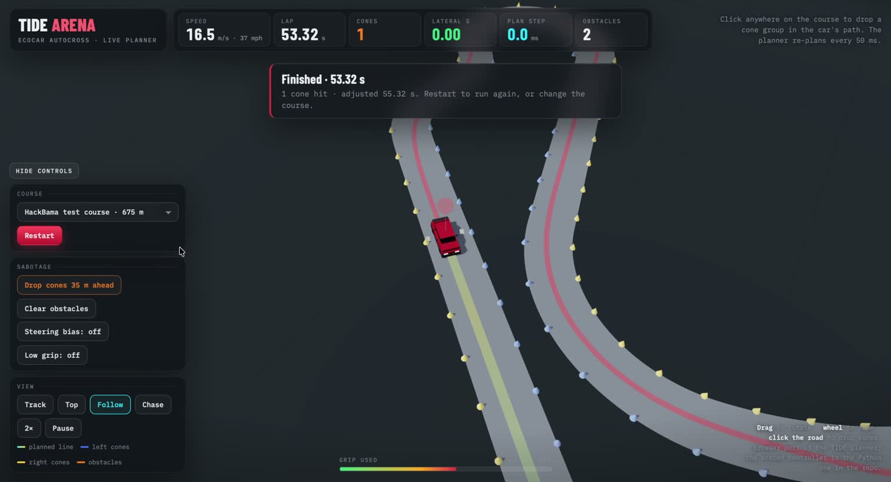
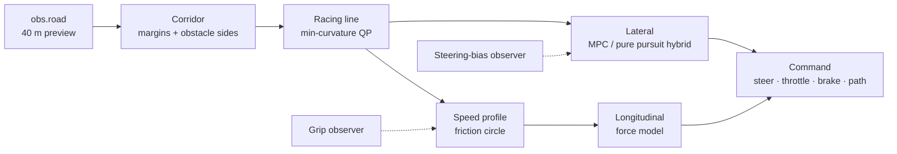
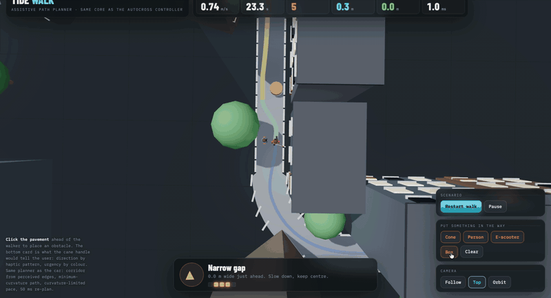

<div align="center">



# TIDE

**Trajectory Intelligence for Dynamic Environments**

No map. 40 metres of road. 50 milliseconds to decide.
An autocross controller for the EcoCAR HackBama 2026 challenge that plans its own racing line from what the car can see, and drives it clean.


</div>

---

## Results

Every public course plus three random ones, bicycle backend, official settings (`python -m autocross selftest`). Baseline is the harness's own pure-pursuit controller.

| Course | Baseline | **TIDE** | Faster by |
| --- | --- | --- | --- |
| hackathon_test | 56.0 s · 2 cones · 61.9 | **44.5 s · 0 cones · 73.7** | 20% |
| practice_basic | 35.9 s · 0 cones · 66.2 | **27.6 s · 0 cones · 74.7** | 23% |
| practice_loop (2 laps) | 92.9 s · 0 cones · 66.5 | **79.6 s · 0 cones · 73.1** | 14% |
| practice_obstacles | 61.2 s · 3 cones · 59.5 | **47.4 s · 0 cones · 73.6** | 23% |
| practice_technical | 39.5 s · 4 cones · 57.5 | **32.3 s · 0 cones · 72.8** | 18% |
| rand_11 · rand_22 · rand_33 | 61.2 · 61.9 · 53.8 s · 12 cones | **47.5 · 48.1 · 43.3 s · 0 cones** | 19–22% |
| **Mean technical points / 75** | **60.7** | **73.6** | |

Scores are the harness's technical points (completion time, path deviation, compute, physical realism; max 75). Compute never exceeds 1.1 ms of the 50 ms step budget, and the process stays under 40 MB of the 1 GB ceiling.

<table>
<tr>
<td width="50%"></td>
<td width="50%"></td>
</tr>
<tr>
<td align="center">Baseline on <code>hackathon_test</code>: 55.98 s, two cones</td>
<td align="center">TIDE on the same course: 44.52 s, clean</td>
</tr>
</table>

---

## How it works

The controller runs every 50 ms and sees only `obs.road`: the perceived centerline, boundaries, corners and unmapped obstacles up to 40 m ahead, in the vehicle frame. It never gets a map and reads nothing from disk. Everything below is numpy.

<table>
<tr>
<td width="50%" valign="top">

### 1. See the corridor 🛣️
The cone lines shrink inward by half a car plus a safety margin that grows with distance, because the far preview is trusted less. Each unmapped obstacle group is blocked out of the corridor on the side with more room, and that side is remembered until the car is past it.

</td>
<td width="50%"></td>
</tr>
<tr>
<td width="50%"></td>
<td width="50%" valign="top">

### 2. Plan the line and the speed 📐
A minimum-curvature racing line is solved inside the corridor as an exact quadratic programme: 41 unknowns, banded solve plus an active-set loop, about 0.2 ms, warm-started from the previous step so the published plan stays consistent. A friction-circle speed profile runs along it: forward pass for power and grip, backward pass for trail braking at 70% of the circle. Road past the horizon is treated as a possible hairpin and planned at full braking.

</td>
</tr>
<tr>
<td width="50%" valign="top">

### 3. Drive it, and watch yourself 🏁
Longitudinal control meets the plan 0.25 s ahead, with pedals capped by the friction circle against the *planned* lateral load and never throttle and brake together. Steering is a speed-scheduled hybrid: a linear time-varying MPC contributes at low speed, pure pursuit plus Stanley takes over above 10 m/s. Two observers run alongside: one measures steering bias from applied versus commanded steer and cancels it, the other lowers the grip budget when the rear axle starts to slide.

</td>
<td width="50%"></td>
</tr>
</table>



### Robust by construction

Every change was re-run through the harness's perturbation batch (`python -m autocross batch`, [`config/robustness.yaml`](config/robustness.yaml)) before it stayed in. Measured on `practice_technical`, bicycle backend, seeds 0 and 1:

| Perturbation | Cones | Technical / 75 |
| --- | --- | --- |
| nominal | 0 | 72.8 |
| start offset 1 m / 6° | 0 | 72.8 |
| noisy cone perception (σ 0.15 m, 15% dropout) | 0 | 72.8 |
| 5% of cones misclassified | 0 | 72.8 |
| 3% steering bias | 0 | 72.7 |
| +15% mass | 0 | 72.5 |
| sight distance 25 m instead of 40 | 0 | 71.3 |
| 100 ms actuator lag | 0 | 71.4 |
| noisy road model (offset σ 0.1 m, heading σ 0.5°) | 0 / 14 by seed | 70.7 / 47.9 |
| 20% less grip | 4 | 63.0 |

Eight of ten perturbations finish clean within 1.5 points of nominal. The two that bite are listed, not hidden: with 20% less grip the grip observer lowers the budget but not fast enough for the hairpin, and a noisy road model is clean on one seed and upsets the planner on the other. One throttle tweak that was worth +0.1 points nominally cost 30 points under road-model noise. The batch caught it. It was reverted.

### What we tried and what we shipped

- **MPC alone vs pure pursuit.** Head to head on eight courses, the LTV-MPC tracked the planned line about 2 points better and lost about 2 points of lap time, because it drives the conservative planned line exactly while pure pursuit cuts it within the tolerance the scorer allows. We shipped the faster hybrid and kept the data. `lateral: mpc` or `lateral: pp` in the controller config switches between them.
- **Lap memory.** The controller stitches everything it sees into a world-frame map every lap (verified exact against the true track offline). On lap 2 of a closed course, the remembered road past the 40 m preview replaces the blind "assume a hairpin" speed limit with the remembered corner speed. Active on 52% of lap 2 of `practice_loop`, and it never changes a decision on an open course.
- **Not reinforcement learning.** There is no learned component. MPC optimises a known vehicle model online, so every line is readable and the car does the same thing every run. The judge-question notes in [`controllers/tide/DEMO_NOTES.md`](controllers/tide/DEMO_NOTES.md) spell out why.

---

## Live demos

Two self-contained pages (React + Three.js from a CDN, no build step) that port the planner core to the browser on simplified physics. The scored controller is the Python one.

<table>
<tr>
<td width="50%" valign="top">

### TIDE Arena 🏎️
Pick a course (HackBama test, technical, speedway, random), click the road to drop cone groups in the car's path, inject a steering bias or low grip, and watch the line re-plan every 50 ms. Track, top, follow and chase cameras.

[`demo/tide_arena.html`](demo/tide_arena.html)

</td>
<td width="50%"></td>
</tr>
<tr>
<td width="50%"></td>
<td width="50%" valign="top">

### TIDE Walk 🦯
The same planner as an assistive path planner for a white-cane user. A pedestrian walks a kerbed sidewalk; drop a cone, person, e-scooter or box in the way and the planner routes around it. The card at the bottom is what the cane handle would tell the user: direction by haptic pattern, urgency by colour. When the way is blocked, it says **Stop**.

[`demo/tide_walk.html`](demo/tide_walk.html)

</td>
</tr>
</table>

```bash
python3 -m http.server 8000      # then open http://localhost:8000/demo/
```

---

## Quick start

**You need:** [Python 3.10–3.12](https://www.python.org). CARLA is optional: the bicycle backend runs everywhere, including macOS.

```bash
# 1. Clone and install (creates .venv, installs the harness, runs a self-check)
git clone https://github.com/GauravS11112003/EcoCAR_HackBama_GauravS.git
cd EcoCAR_HackBama_GauravS
./scripts/setup.sh               # Windows: powershell -ExecutionPolicy Bypass -File scripts\setup.ps1
source .venv/bin/activate        # Windows: .venv\Scripts\Activate.ps1

# 2. Watch TIDE drive the test course with a live top-down view
python -m autocross run -c controllers/tide/controller.py -t tracks/hackathon_test.yaml --backend bicycle --view

# 3. Reproduce the results table (about 15 s)
python -m autocross selftest -c controllers/tide/controller.py
python -m autocross selftest -c controllers/baseline_pure_pursuit.py
```

Every run writes a folder under `runs/` with `report.png`, `telemetry.csv`, `events.json` and `summary.json`.

> [!TIP]
> - **Have CARLA 0.9.16?** Start it with `scripts/start_carla.sh`, then add `--carla` to `selftest` or drop `--backend bicycle` from `run`. The official evaluation counts CARLA and the bicycle model for half each.
> - **Robustness sweep:** `python -m autocross batch -c controllers/tide/controller.py` runs courses × perturbations × seeds from [`config/robustness.yaml`](config/robustness.yaml).
> - **Tune it:** every gain is a key in the controller config. Pass `--controller-config my.yaml` with, for example, `lateral: mpc` or `memory_mode: extend`.
> - **Debug values** such as `dbg_w_mpc` (MPC share of the steering command) and `dbg_v_hor_used` (lap-memory horizon speed) appear as columns in `telemetry.csv`.

## Tests

```bash
python -m pytest                 # harness suite, bicycle backend, no CARLA needed
python -m autocross selftest -c controllers/tide/controller.py     # sandbox rules + every public course
```

## What's inside

| Path | What it is |
| --- | --- |
| [`controllers/tide/controller.py`](controllers/tide/controller.py) | The submission. One file, one class, numpy only |
| [`controllers/tide/DEMO_NOTES.md`](controllers/tide/DEMO_NOTES.md) | Design notes, the MPC vs pure-pursuit data, lap memory, and answers to likely judge questions |
| [`demo/`](demo) | TIDE Arena and TIDE Walk browser demos |
| [`autocross/`](autocross) | The simulation harness: CARLA and bicycle backends, road model, sandbox, rules, scoring, plots |
| [`tracks/`](tracks) | Public test and practice courses, plus the three random courses used above |
| [`config/`](config) | Official sim, scoring and robustness settings |
| [`docs/HARNESS.md`](docs/HARNESS.md) | Full harness documentation: rules, scoring, commands, courses, configuration, MIL/SIL notes |

The controller runs in a sandbox with one CPU core, no GPU, a 1 GB memory ceiling and a 50 ms deadline per step, and it cannot read course files or earlier runs. The `Controller` interface is the model-in-the-loop plug-in point, so the same planner could be ported to Simulink or Embedded Coder for a real vehicle.

## Team

Built by **Gaurav Shrivastava** for the EcoCAR autocross challenge at HackBama 2026, University of Alabama.
Simulation harness by the UA EcoCAR team: [dszurek/ecocar-hackathon-sim](https://github.com/dszurek/ecocar-hackathon-sim).
